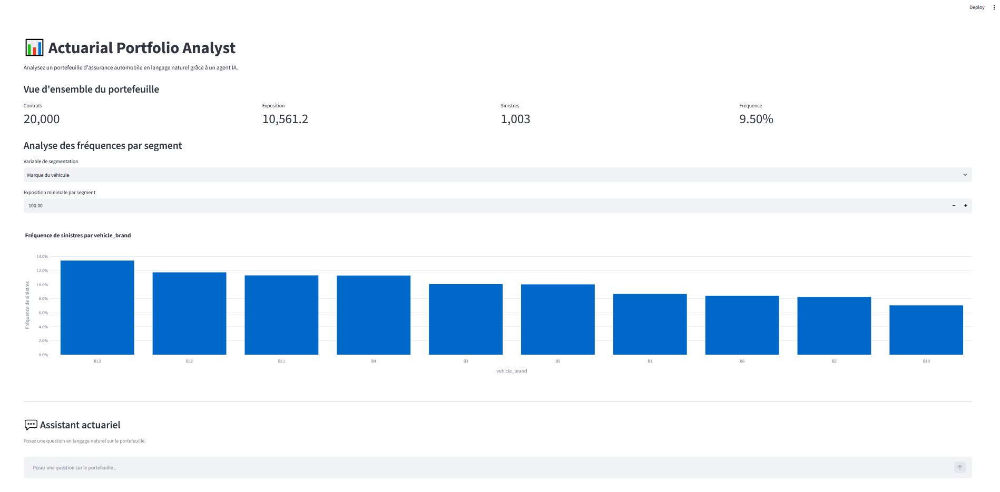

# READ ME : Actuarial Portfolio Analyst Agent

## 🇫🇷 Français

Application d'analyse actuarielle d'un portefeuille d'assurance automobile combinant Python, des méthodes actuarielles et un agent IA basé sur un LLM.

L'application permet à l'utilisateur de poser des questions en langage naturel sur un portefeuille d'assurance. L'agent IA interprète la demande, sélectionne l'outil actuariel approprié et restitue des résultats calculés directement à partir des données du portefeuille.

> **Principe central : le LLM orchestre ; Python calcule.**

### Aperçu de l'application



### Objectif du projet

L'objectif de ce projet est d'illustrer comment un agent IA peut assister l'analyse d'un portefeuille d'assurance tout en conservant des calculs quantitatifs déterministes et reproductibles.

Plutôt que de demander au LLM de calculer lui-même les indicateurs actuariels, l'agent délègue les calculs à des fonctions Python dédiées.

Exemples de questions prises en charge :

- Quelle est la fréquence globale de sinistres ?
- Quelle est la fréquence de sinistres par type de carburant ?
- Quelles marques de véhicules présentent les fréquences les plus élevées ?
- Quelle est la fréquence de sinistres des conducteurs de moins de 30 ans ?
- Le portefeuille présente-t-il des problèmes de qualité des données ?

### Fonctionnalités actuelles

- Résumé du portefeuille
- Calcul de la fréquence de sinistres
- Analyse de la fréquence par segment
- Identification des segments à fréquence élevée avec seuil d'exposition minimale
- Filtrage du portefeuille
- Contrôles de qualité des données
- Visualisations interactives avec Plotly
- Questions actuarielles en langage naturel via un agent IA
- Interface web Streamlit

## Architecture

L'application sépare volontairement le raisonnement en langage naturel des calculs actuariels.

```text
Utilisateur
    │
    ▼
Interface Streamlit
    │
    ▼
Agent IA (LLM)
    │
    │ Tool Calling
    ▼
Outils actuariels Python
    │
    ├── Résumé du portefeuille
    ├── Fréquence de sinistres
    ├── Analyse par segment
    ├── Segments à risque
    ├── Filtrage
    └── Contrôles de qualité
    │
    ▼
Portefeuille automobile
```

L'agent IA ne calcule pas directement les indicateurs du portefeuille. Il sélectionne l'outil Python adapté à la question de l'utilisateur. Les calculs sont ensuite réalisés avec Python et pandas avant que le LLM interprète et présente les résultats.

### Données

Le projet utilise un échantillon de **20 000 contrats** issu du jeu de données public **freMTPL2**, couramment utilisé pour l'étude de la tarification automobile en assurance.

Le portefeuille contient notamment :

- l'exposition au risque ;
- le nombre de sinistres ;
- l'âge du conducteur ;
- l'âge et la puissance du véhicule ;
- le bonus-malus ;
- la marque et le type de carburant ;
- la zone géographique et la région.

Le fichier utilisé par l'application est :

```text
data/sample_portfolio.csv
```

Un échantillonnage reproductible est réalisé avec `random_state=42`.

## Installation et utilisation

### 1. Cloner le dépôt

```bash
git clone https://github.com/Hrazafin78/actuarial-portfolio-analyst-agent.git
cd actuarial-portfolio-analyst-agent
```

### 2. Créer un environnement virtuel

Sous Windows :

```bash
python -m venv .venv
.venv\Scripts\activate
```

### 3. Installer les dépendances

```bash
pip install -r requirements.txt
```

### 4. Configurer la clé API OpenAI

Créer un fichier `.env` à la racine du projet en utilisant `.env.example` comme modèle :

```text
OPENAI_API_KEY=your_api_key_here
```

Le fichier `.env` est exclu du dépôt Git et ne doit jamais être publié.

### 5. Lancer l'application

```bash
python -m streamlit run app.py
```

L'interface Streamlit est alors accessible depuis le navigateur.

### 6. Lancer les tests

```bash
python -m pytest
```

Les tests vérifient notamment les calculs de fréquence, les analyses par segment, les filtres et certains contrôles de qualité des données.

---

## 🇬🇧 English

An AI-powered application for analyzing a motor insurance portfolio using Python, actuarial methods and an LLM-based agent.

The application allows users to ask questions about an insurance portfolio in natural language. The AI agent interprets the request, selects the appropriate actuarial tool, and returns results computed directly from the portfolio data.

> **Core principle: The LLM orchestrates; Python computes.**

### Project objective

The goal of this project is to demonstrate how AI agents can support actuarial portfolio analysis while keeping quantitative calculations deterministic and reproducible.

Instead of asking the LLM to calculate actuarial indicators itself, the agent delegates calculations to dedicated Python functions.

Examples of supported questions:

- What is the overall claim frequency?
- What is the claim frequency by fuel type?
- Which vehicle brands have the highest claim frequency?
- What is the claim frequency for drivers under 30?
- Are there any data quality issues in the portfolio?

### Current features

- Portfolio summary
- Claim frequency calculation
- Frequency analysis by segment
- Detection of high-frequency segments with minimum exposure thresholds
- Portfolio filtering
- Data quality checks
- Interactive Plotly visualizations
- Natural-language actuarial queries through an AI agent
- Streamlit web interface

## Architecture

The application deliberately separates natural-language reasoning from actuarial calculations.

```text
User
  │
  ▼
Streamlit Interface
  │
  ▼
AI Agent (LLM)
  │
  │ Tool Calling
  ▼
Actuarial Python Tools
  │
  ├── Portfolio summary
  ├── Claim frequency
  ├── Segment analysis
  ├── Risk segments
  ├── Portfolio filtering
  └── Data quality checks
  │
  ▼
Motor Insurance Portfolio
```

The AI agent does not directly calculate portfolio indicators. It selects the appropriate Python tool according to the user's question. Calculations are performed with Python and pandas before the LLM interprets and presents the results.

### Dataset

The project uses a **20,000-policy sample** from the public **freMTPL2** motor insurance dataset.

The portfolio includes variables such as:

- risk exposure;
- number of claims;
- driver age;
- vehicle age and power;
- bonus-malus;
- vehicle brand and fuel type;
- geographical area and region.

The dataset used by the application is stored in:

```text
data/sample_portfolio.csv
```

The sample is reproducible using `random_state=42`.

## Installation and usage

### 1. Clone the repository

```bash
git clone https://github.com/Hrazafin78/actuarial-portfolio-analyst-agent.git
cd actuarial-portfolio-analyst-agent
```

### 2. Create a virtual environment

On Windows:

```bash
python -m venv .venv
.venv\Scripts\activate
```

### 3. Install dependencies

```bash
pip install -r requirements.txt
```

### 4. Configure the OpenAI API key

Create a `.env` file at the project root using `.env.example` as a template:

```text
OPENAI_API_KEY=your_api_key_here
```

The `.env` file is excluded from Git and must never be committed.

### 5. Run the application

```bash
python -m streamlit run app.py
```

The Streamlit interface will then be available in your browser.

### 6. Run the tests

```bash
python -m pytest
```

The tests cover claim-frequency calculations, segment analysis, portfolio filtering and selected data-quality checks.