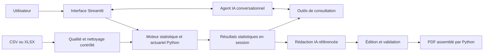

# Actuarial Portfolio Analyst Agent V2

**Explorer un portefeuille IARD, fiabiliser les données et documenter les constats actuariels avec un agent IA fondé sur des calculs Python.**

Ce projet relie un parcours d’analyse actuarielle à une interface conversationnelle :
préparer un portefeuille, comprendre sa structure et sa sinistralité, approfondir les
résultats disponibles puis produire une synthèse révisable. Il s’adresse aux actuaires
et analystes qui souhaitent rapprocher diagnostic de données, exploration statistique
et restitution dans un même environnement.

> Python calcule les indicateurs. L’agent sélectionne les outils, explore les résultats statistiques
> et formule les commentaires. Les décisions et la validation métier restent humaines.

Il s’agit d’un prototype applicatif local, avec tests automatisés. Aucune performance
métier, économie de temps ou fiabilité des réponses en production n’est revendiquée.


## Un parcours actuariel en quatre étapes

| Espace | Fonctionnalités implémentées | Apport pour l’analyste |
|---|---|---|
| Qualité & Nettoyage | Import CSV/XLSX, valeurs manquantes, doublons, types, atypies IQR, alertes statistiques ; corrections choisies et journalisées sur une copie | Examiner les anomalies avant d’interpréter les indicateurs |
| Analyse descriptive | Distributions, statistiques numériques, associations, indicateurs actuariels par segment et évolutions annuelles selon les données disponibles | Comprendre la composition du risque et les écarts descriptifs |
| Assistant IA | Questions en français, catalogue des analyses, consultation des statistiques, associations ciblées, sélection et classement de segments | Accéder aux résultats sans naviguer manuellement dans chaque tableau |
| Rapports IA | Six sections proposées, format synthétique ou complet, édition, preuves chiffrées et export PDF avec graphique disponible | Préparer une restitution structurée et traçable à relire |

Les rôles actuariels sont renseignés manuellement. Selon le mapping, Python calcule
la fréquence, le coût moyen, la prime pure, le ratio S/P et les primes moyennes.
Aucun portefeuille spécifique n’est imposé ; les unités, périodes et garanties
comparées doivent néanmoins être vérifiées par l’utilisateur.

## Ce que l’agent IA apporte

L’utilisateur exprime une intention d’analyse. L’agent choisit parmi des outils
explicitement autorisés et interprète leurs résultats. Par exemple, il peut demander
un classement des segments après application d’un seuil d’exposition, ou rechercher
l’association d’une paire de variables sans se limiter au classement global.

Les outils consultent les résultats déjà calculés : ils ne produisent pas de code Python
libre et ne construisent pas de nouvelles populations de contrats. La rédaction des
rapports utilise un catalogue distinct de preuves issues des mêmes résultats statistiques. Les
références comme `[E1, E2]` relient les commentaires aux tableaux Python.



## Technologies et compétences mobilisées

| Domaine | Mise en œuvre |
|---|---|
| Actuariat IARD | Exposition, sinistralité, ratios de synthèse, comparaisons par segments, lecture critique des faibles effectifs |
| Python et Data Science | pandas, NumPy, SciPy ; statistiques descriptives, Pearson, V de Cramér corrigé et eta carré |
| Intégration d’agents IA | SDK OpenAI, Responses API, tool calling, schémas JSON stricts, contexte conversationnel |
| Application et restitution | Streamlit, Plotly, openpyxl, ReportLab, PDF éditable avant export |
| Qualité logicielle | pytest, tests Streamlit AppTest, faux clients API, contrôles de non-régression et de cohérence |

## Installation et lancement

Prérequis : Python **3.10** pour reproduire l’environnement local vérifié, Git et un
terminal ouvert à la racine du dépôt. Les versions directes sont fixées dans
`requirements.txt` ; les dépendances transitives ne sont pas intégralement verrouillées.

```powershell
git clone https://github.com/Hrazafin78/actuarial-portfolio-analyst-agent.git
cd actuarial-portfolio-analyst-agent
python -m venv .venv
.venv\Scripts\python.exe -m pip install -r requirements.txt
```

La branche `main` porte la V2 officielle. Le tag `v2.0.0` permet de retrouver
l’état de cette publication ; le tag `v1.0.0` conserve la première version.

Si `.env` n’existe pas, copier `.env.example` vers `.env`, puis y renseigner
`OPENAI_API_KEY`. Ne jamais publier la clé. Choisir des modèles accessibles au compte :

```dotenv
OPENAI_API_KEY=votre_cle_locale
OPENAI_MODEL_V2=identifiant_du_modele_compatible
OPENAI_REPORT_MODEL=identifiant_du_modele_compatible
```

Les identifiants ci-dessus sont des emplacements à remplacer, pas des modèles
exécutables. Le code utilise actuellement `gpt-6-luna` comme repli si les variables
sont absentes ; sa disponibilité sur le compte doit être vérifiée. Le modèle de
rapport doit prendre en charge les sorties structurées ; celui de l’assistant, les
appels de fonctions. Les appels IA nécessitent une connexion et peuvent être facturés.
Les traitements statistiques locaux ne nécessitent pas de clé.

```powershell
.venv\Scripts\python.exe -m streamlit run app.py
```

Importer ensuite son fichier dans **Qualité & Nettoyage**, puis configurer et lancer
l’analyse. Les espaces **Assistant IA** et **Rapports IA** utilisent cette analyse.
Voir le [guide d’utilisation](docs/utilisation.md) pour le mapping et les exports.

## Exemples de questions

Adapter les noms et modalités aux colonnes effectivement disponibles :

- « Quelles variables et analyses sont disponibles ? »
- « Donne les statistiques descriptives de `driver_age`. »
- « Quelle est l’association entre `driver_age` et `vehicle_power` ? »
- « Classe les cinq régions par fréquence décroissante, avec au moins cent unités d’exposition. »
- « Compare les modalités diesel et essence de `vehicle_fuel`. »
- « Quelles évolutions annuelles sont disponibles et quelles limites faut-il signaler ? »

## Validation, limites et évolutions

```powershell
.venv\Scripts\python.exe -m pip install -r requirements-dev.txt
.venv\Scripts\python.exe -m pytest
```

Les tests vérifient les calculs, les outils, les contrôles de rédaction et PDF ainsi
que la navigation. Les appels IA y sont simulés : ils ne prouvent pas la qualité des
réponses d’un modèle réel. Voir [validation et limites](docs/validation.md).

Le projet ne propose pas encore de tarification GLM, de provisionnement, d’inférence
causale ou de filtrage conversationnel arbitraire des contrats. Les résultats statistiques sont
bornés, les durées de génération et le nombre de pages ne sont pas garantis. Il n’y
a pas de stockage permanent des sessions, d’authentification applicative ni de
configuration de déploiement multi-utilisateur validée.

Les perspectives comprennent les segmentations croisées, une évaluation des réponses
sur des cas actuariels annotés, des restitutions plus riches et un déploiement avec
gouvernance des données. Ces pistes ne sont pas présentées comme implémentées.

## Documentation et publication

- [Architecture et principaux modules](docs/architecture.md)
- [Guide d’utilisation et indicateurs](docs/utilisation.md)
- [Agent IA, outils et rapports](docs/agent-ia.md)
- [Données, confidentialité et publication](docs/securite.md)
- [Tests, limites et perspectives](docs/validation.md)

Les données locales, diagnostics enregistrés et rapports IA générés sont exclus des nouveaux ajouts Git par
`.gitignore`. Cette exclusion ne supprime pas des fichiers déjà suivis ni des secrets
dans l’historique : consulter les [vérifications avant publication](docs/securite.md).
La V2 est l’application principale sur `main`. La V1 reste accessible au tag `v1.0.0`.
