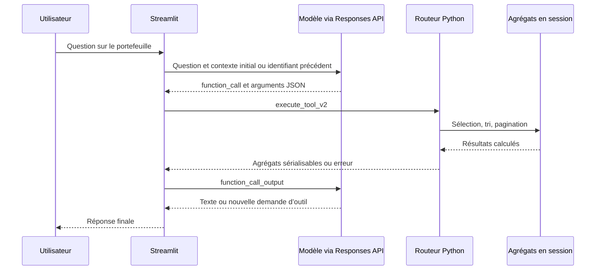

# Agent IA, appels d’outils et rédaction

[Retour au README](../README.md)

## Conversation : le modèle orchestre, les outils consultent

`ask_agent_v2()` envoie un contexte compact issu de `build_llm_context()` au premier
tour. Les tours suivants utilisent `previous_response_id` pour poursuivre la chaîne
Responses API. Les instructions métier sont retransmises lors des appels.

Plusieurs appels peuvent être demandés dans une même réponse. La boucle est bornée
à huit itérations de traitement ; dépasser cette borne produit une erreur. Certaines
erreurs d’arguments sont renvoyées au modèle comme résultats d’outil. Aucun `eval`,
exécuteur de code libre ou outil de lecture de contrats n’est exposé.

| Outil | Accès fourni |
|---|---|
| `list_available_analyses` | Variables, rôles, mapping, analyses disponibles, colonnes et limites |
| `get_portfolio_overview` | Contexte compact de synthèse, exemples et indicateurs disponibles |
| `get_variable_statistics` | Statistiques d’une variable et distribution catégorielle si disponible |
| `get_associations` | Classement global, associations d’une variable ou d’une paire, filtre de méthode |
| `get_segment_analysis` | Modalités existantes, tri numérique et seuils d’effectif/exposition |
| `get_temporal_analysis` | Résultats annuels existants avec sélection, tri et seuils |

Les outils sont déclarés avec schémas JSON stricts et `additionalProperties: false`.
Les paramètres optionnels sont requis mais acceptent `null` dans les schémas enrichis.
Le routeur vérifie notamment les variables, méthodes, colonnes de tri, modalités et
seuils. Les pages sont limitées à cent lignes ; `next_offset` indique la suite.
Tri et filtres s’appliquent avant pagination. Le contexte initial peut être tronqué :
il ne remplace pas une consultation ciblée des outils.

## Rapports : une chaîne distincte

Le générateur réutilise les agrégats descriptifs et `build_llm_context()`, mais ne
lance pas la boucle conversationnelle de tool calling. `build_evidence()` construit
un catalogue borné de faits identifiés par `E1`, `E2`, etc. Il inclut des indicateurs,
extraits de distributions, segments, associations et résultats annuels. La
numérotation dépend du rapport, ce n’est pas un identifiant permanent de métrique.

Le modèle reçoit ce catalogue et un schéma JSON dont les clés correspondent aux
sections sélectionnées. Il rédige les textes et cite `[[E1]]`. Python vérifie :

- présence et validité des sections ;
- absence de section vide et limite de longueur ;
- existence des identifiants cités ;
- absence de chiffres libres en dehors des références ;
- absence de certaines formulations causales explicites.

Les syntaxes de citations reconnues peuvent être normalisées si leurs références
existent. Les sections invalides sont soumises à deux corrections au maximum :
trois appels de rédaction sont donc possibles. Les sections validées sont conservées.
Un échec persistant bloque la publication de la nouvelle génération dans l’interface.

L’aperçu affiche des citations compactes et des tableaux lisibles. `evidence_rows()`
présente une sélection d’indicateurs des faits cités ; les sources techniques sont
consultables séparément dans l’application. ReportLab assemble le texte, les tableaux,
le graphique de distribution disponible et les avertissements. Les chiffres et
coordonnées du graphique sont issus de Python, pas produits par le modèle.

## Ce que les contrôles garantissent et ne garantissent pas

Un identifiant valide garantit qu’un fait existe, pas qu’une phrase l’interprète
correctement. Le texte conversationnel ne bénéficie pas du même validateur numérique
que les rapports. La détection de causalité dans les rapports est lexicale et partielle.
Un chiffre écrit en lettres ou une conclusion qualitative infondée ne sont pas
nécessairement détectés. La résistance aux injections est principalement assurée par
les instructions et la limitation des capacités ; elle n’est pas démontrée exhaustive.

La recommandation d’investigations complémentaires est une production du modèle,
pas la preuve que ces investigations ont été exécutées. La validation métier demeure
nécessaire avant utilisation dans une décision actuarielle.
