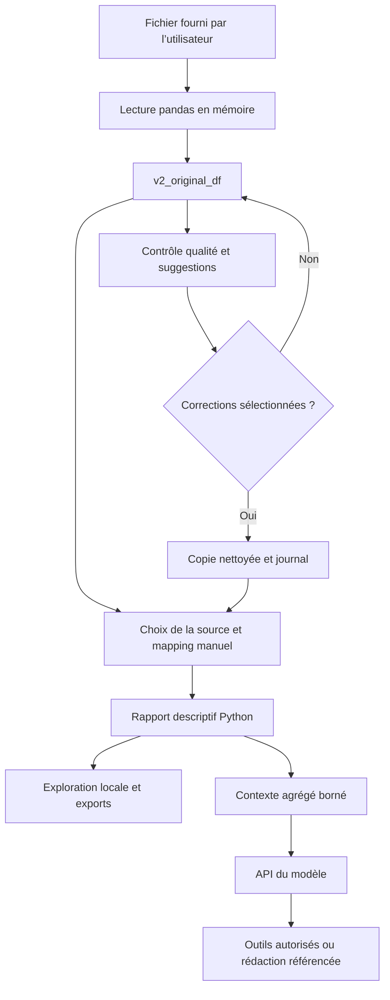

# Architecture technique

[Retour au README](../README.md)

## Séparation des responsabilités

L’interface ne délègue aucun calcul de sinistralité au modèle. Les fonctions Python
produisent un dictionnaire de résultats contenant des DataFrames agrégés, des
indicateurs, le mapping et les avertissements. Le modèle ne dispose pas d’un accès
général à pandas, au système de fichiers ou aux contrats individuels par ses outils.

| Module | Responsabilité et principales entrées |
|---|---|
| `app.py` | Configuration Streamlit et routage des quatre espaces |
| `ui.py` | Thème, navigation, conservation des contrôles et `active_analysis()` |
| `v2_page.py` | Lecture en mémoire des CSV/XLSX, orchestration qualité/nettoyage et exports |
| `quality_checker.py` | `generate_quality_report()` : structure, manquants, doublons, types, IQR et alertes statistiques |
| `data_cleaner.py` | `suggest_cleaning_actions()`, `apply_cleaning_actions()`, `generate_cleaning_report()` |
| `descriptive_analyzer.py` | Rôles, validation du mapping, distributions, associations, segments, temporalité, `generate_descriptive_report()` et `build_llm_context()` |
| `descriptive_page.py` | Configuration, exploration des agrégats et exploration détaillée de paires calculée localement |
| `agent_tools_v2.py` | Schémas des outils et routeur autorisé `execute_tool_v2()` |
| `agent_v2.py` | `ask_agent_v2()` : client Responses API et boucle d’appels d’outils |
| `agent_page.py` | Affichage du chat et gestion de son historique |
| `report_generator.py` | Catalogue de preuves, rédaction structurée, validation et assemblage PDF |
| `report_page.py` | Options, édition, aperçu et téléchargement du rapport |
| `validate_quality.py` | Validation manuelle indépendante, configurée pour le fichier local et sa clé métier |

Les noms contenant `v2` sont historiques et ne désignent pas une seconde interface
accessible : seule la V2 est exposée dans l’application.

## Parcours des données

Le chargement dans l’interface ne sauvegarde pas automatiquement le fichier importé
sur disque. pandas lit le CSV avec détection ou choix du séparateur et essais de
décodage UTF-8 avec BOM, CP1252 et Latin-1. XLSX utilise openpyxl. Le parcours
interactif n’impose pas `data/portefeuille.csv` ; ce chemin concerne le script de
validation indépendant.

Le moteur de qualité accepte un mapping de contrôles de cohérence actuarielle.
L’écran qualité transmet actuellement la clé métier sélectionnée, pas le mapping
actuariel défini plus tard dans l’analyse descriptive. Les validations de ce dernier
sont assurées par `validate_actuarial_mapping()` : ne pas confondre ces deux couches.

## État de session et dépendances

| Groupe | Exemples de clés | Durée de validité |
|---|---|---|
| Import | `v2_original_df`, `v2_file_name` | Jusqu’au remplacement ou à la perte de session |
| Qualité/nettoyage | `v2_quality_report`, `v2_cleaned_df`, `v2_cleaning_log` | Dépend de la source et des actions |
| Analyse | `v2d_report`, `v2d_signature`, `v2d_current_signature` | Dépend de la source, du mapping, des rôles et options |
| Conversation | `v2_agent_messages`, `v2_agent_previous_response_id` | Dépend de la signature d’analyse |
| Rapport | `report_ai_document`, `report_ai_edit_*`, `report_ai_pdf` | Dépend de l’analyse et des options de génération |

La signature descriptive inclut l’identité en mémoire de la source, le mapping, les
rôles et les options. Ce mécanisme protège le parcours interactif ; il ne constitue
pas une empreinte persistante des données. `preserve_controls()` évite la perte des
valeurs de widgets absents lors du passage à un autre espace. `active_analysis()`
vérifie la correspondance de la source et de la configuration avant d’ouvrir le chat
ou les rapports. Un import ou nettoyage invalide les résultats dépendants ; une
nouvelle analyse réinitialise la conversation. Le rapport rédigé est lié aussi à
l’objet de résultats courant.

Les calculs complets nécessitent une action explicite. Seule la vue statistique
sélectionnée est rendue, mais certaines préparations et certains graphiques locaux
sont reconstruits lors des interactions. Il n’existe pas de cache persistant ni de
base de données de sessions. L’application n’offre pas de restauration après arrêt.
